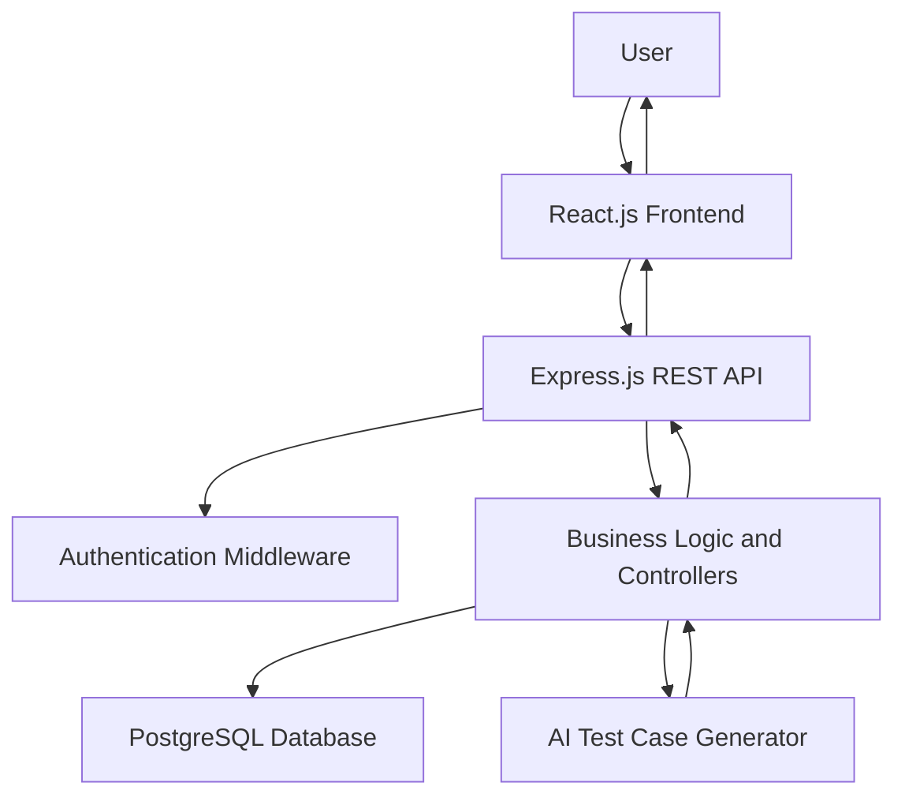

# TestPilot-AI – AI-Assisted Software Testing and Test Case Management System

An AI-assisted software testing system designed to simplify test case generation, management, and manual test execution.

TestPilot-AI is a full-stack web application built using the PERN stack (PostgreSQL, Express.js, React.js, and Node.js). It helps users generate test cases from software requirements, review and update them, record manual execution results, and monitor testing progress through a dashboard.

---

## Overview

Software testing is an essential part of the Software Development Life Cycle (SDLC). Writing test cases, managing them, executing tests, and tracking results can become time-consuming when handled manually.

TestPilot-AI aims to simplify these activities by providing a centralized platform for AI-assisted test case generation and test case management.

Users can enter software requirements, generate test cases with AI assistance, review and edit the generated cases, execute tests manually, and monitor their results.

## Key Features

- **User Authentication:** User registration and login with password hashing and JWT-based authentication.
- **AI-Assisted Test Case Generation:** Generate test cases based on software requirements.
- **Test Case Management:** View, review, and update generated test cases.
- **Manual Test Execution:** Execute test cases and record testing results.
- **Execution Status Tracking:** Track test results using PASSED, FAILED, and SKIPPED statuses.
- **Testing Dashboard:** Monitor test case statistics and testing progress.
- **Failure Notes:** Add optional notes when a test execution fails.

> Note: AI generation depends on the configured AI provider. A local/demo fallback may be used when live AI configuration is unavailable.

## Technology Stack

| Category | Technologies |
|---|---|
| Frontend | React.js, JavaScript, Vite |
| Backend | Node.js, Express.js |
| Database | PostgreSQL |
| Authentication | JWT, bcrypt |
| API Communication | REST API |
| Development Tools | Visual Studio Code, Git, GitHub, Postman |

## System Architecture

TestPilot-AI follows a client-server architecture using the PERN stack.



### Architecture Components

- **React.js:** Provides the user interface and handles frontend interactions.
- **Node.js and Express.js:** Handle application logic and REST API requests.
- **PostgreSQL:** Stores user information, test cases, and test execution records.
- **JWT:** Supports authenticated access to protected API endpoints.
- **AI Integration:** Assists with generating test cases from software requirements.

## Application Workflow

The main application workflow is:

1. Register a new account or log in.
2. Access the testing dashboard.
3. Enter a software requirement.
4. Generate test cases using AI assistance.
5. Review and update generated test cases.
6. Save and manage test cases.
7. Execute test cases manually.
8. Record execution results.
9. Monitor testing progress through the dashboard.

## Database Structure

The PostgreSQL database schema includes the following tables:

| Table | Purpose |
|---|---|
| `users` | Stores user information. |
| `roles` | Stores role information. |
| `projects` | Stores project information. |
| `project_members` | Stores project membership information. |
| `requirements` | Stores software requirements. |
| `test_cases` | Stores test case information. |
| `requirement_test_cases` | Connects requirements with test cases. |
| `test_executions` | Stores test execution records. |
| `defects` | Stores defect-related information. |
| `ai_analysis_records` | Stores AI analysis-related records. |

The database schema is maintained in `database/schema.sql`.

*The database schema contains structures beyond the current MVP functionality. Not every table represents a completed user-facing feature.*

## Project Structure

The project is organized into frontend, backend, database, and documentation directories.

```text
TestPilot-AI/
│
├── backend/
│   └── src/
│       ├── config/
│       │   └── database.js
│       │
│       ├── controllers/
│       │   ├── authController.js
│       │   └── qualityController.js
│       │
│       ├── middleware/
│       │   └── authMiddleware.js
│       │
│       ├── routes/
│       │   ├── authRoutes.js
│       │   └── qualityRoutes.js
│       │
│       ├── services/
│       │   └── testCaseGenerator.js
│       │
│       ├── db/
│       │   └── setup.js
│       │
│       └── server.js
│
├── frontend/
│   └── src/
│       ├── components/
│       ├── pages/
│       ├── services/
│       ├── App.jsx
│       ├── main.jsx
│       └── styles.css
│
├── database/
│   └── schema.sql
│
├── documentation/
│
└── README.md
```

## Getting Started

Follow these instructions to run the project locally.

### Prerequisites

Make sure the following tools are installed:

- Node.js
- npm
- PostgreSQL
- Git

### 1. Clone the Repository

```bash
git clone <YOUR_GITHUB_REPOSITORY_URL>
```

Navigate to the project directory:

```bash
cd TestPilot-AI
```

### 2. Set Up the PostgreSQL Database

Open PostgreSQL and create a database:

```sql
CREATE DATABASE testpilot_ai;
```

Configure the backend environment variables using the example below.

Then navigate to the backend directory:

```bash
cd backend
```

Install the dependencies:

```bash
npm install
```

Run the existing database setup script:

```bash
npm run db:setup
```

This initializes the database using the project's schema setup.

### 3. Configure Backend Environment Variables

Create a `.env` file inside the `backend` directory.

Example configuration:

```env
PORT=5000

DB_HOST=localhost
DB_PORT=5433
DB_NAME=testpilot_ai
DB_USER=postgres
DB_PASSWORD=your_postgresql_password
DB_SSL=false

JWT_SECRET=replace_with_a_secure_random_secret

FRONTEND_ORIGIN=http://localhost:5174

DATABASE_URL=
```

Important:

- Update database credentials according to your local PostgreSQL configuration.
- The frontend origin must match the actual Vite development server URL.
- Keep `DATABASE_URL` empty when using the individual database configuration variables.
- Configure any AI provider credentials using the environment variable names expected by the existing AI generator service.
- Never commit real `.env` files or API keys to GitHub.

### 4. Start the Backend

From the `backend` directory:

```bash
npm run dev
```

The backend API runs on:

```text
http://localhost:5000
```

Health check endpoint:

```text
http://localhost:5000/api/health
```

### 5. Configure and Start the Frontend

Open another terminal:

```bash
cd frontend
```

Install frontend dependencies:

```bash
npm install
```

Create a `.env` file inside the `frontend` directory if needed:

```env
VITE_API_URL=http://localhost:5000/api
```

Start the frontend:

```bash
npm run dev
```

Vite will display the local frontend URL in the terminal. Open that URL in your browser.

### 6. Build the Frontend

To create a production build:

```bash
npm run build
```

## API Endpoints

The following endpoints are part of the current backend implementation.

| Method | Endpoint | Description |
|---|---|---|
| POST | `/api/auth/register` | Register a new user |
| POST | `/api/auth/login` | Authenticate a user |
| GET | `/api/auth/me` | Retrieve the authenticated user |
| GET | `/api/test-cases` | Retrieve test cases |
| POST | `/api/requirements/generate` | Generate test cases from a requirement |
| PATCH | `/api/test-cases/:id` | Update an existing test case |
| POST | `/api/test-cases/:id/executions` | Record a manual test execution |

Protected endpoints require a valid JWT authentication token.

## Test Execution Statuses

TestPilot-AI supports three manual test execution statuses:

| Status | Description |
|---|---|
| PASSED | The test case meets the expected result. |
| FAILED | The actual result does not meet the expected result. |
| SKIPPED | The test case was not executed. |

Execution results are stored in the database and used to monitor testing progress.

## Current Project Scope and Limitations

TestPilot-AI is developed as an undergraduate Software Engineering project focusing on the core features of AI-assisted test case management.

The current scope focuses on:

- User authentication.
- AI-assisted test case generation.
- Test case viewing and updating.
- Manual test execution.
- Basic testing statistics.

The following features are outside the current MVP scope:

- Automated browser testing using Playwright or Selenium.
- Advanced defect and bug management.
- Complex project and team management.
- CI/CD integration.
- Advanced analytics and reporting.
- Email notifications.

These features may be considered for future development.

## Future Improvements

Possible future enhancements include:

- Automated browser testing integration.
- Dedicated defect tracking functionality.
- Improved test execution history.
- Advanced test reporting.
- Team collaboration features.
- Additional AI-assisted testing capabilities.

## Learning Outcomes

Through this project, I aim to gain practical experience in:

- Full-stack web application development.
- Building RESTful APIs using Node.js and Express.js.
- Developing frontend interfaces with React.js.
- Designing and managing relational databases using PostgreSQL.
- Implementing JWT authentication and password hashing.
- Integrating frontend and backend applications.
- Understanding software testing and test case design.
- Managing source code using Git and GitHub.
- Debugging and maintaining a full-stack application.

## Author

**Malshi Dewmini**

Undergraduate Software Engineering Student

---

*TestPilot-AI – Making software testing more organized with AI assistance.*
