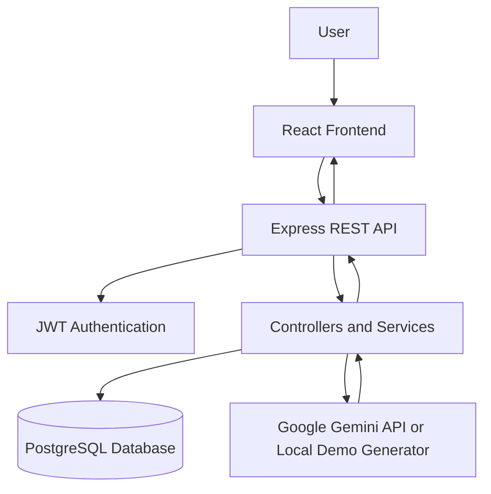

# TestPilot-AI – AI-Assisted Software Testing and Test Case Management System

An internship-level PERN application for generating, reviewing, and managing software test cases and recording manual test execution results.

## Overview

TestPilot-AI helps users turn software requirements into suggested test scenarios. Users can review and edit generated test cases, manually execute them, record **PASSED**, **FAILED**, or **SKIPPED** results, and monitor the latest results through a dashboard.

The application is built using **PostgreSQL, Express.js, React.js, and Node.js (PERN)**, with Google Gemini API integration for AI-assisted test case generation.

## MVP Features

- User registration and login.
- Password hashing with `bcryptjs` and JWT-based protected API routes.
- AI-assisted test case generation from software requirements using Google Gemini.
- A local demo generator when no Gemini API key is configured.
- View and edit saved test cases.
- Manual test execution with **PASSED**, **FAILED**, and **SKIPPED** results.
- Optional execution notes for failed tests.
- Dashboard statistics calculated from the latest execution result of each test case.
- Execution history for the current user.

**AI integration:** TestPilot-AI uses the Google Gemini API to generate test cases from software requirements. If `GEMINI_API_KEY` is not configured, the application uses a built-in local demo generator. Demo-generated test cases are not live AI responses.

## Technology Stack

| Layer | Technologies |
|---|---|
| Frontend | React, JavaScript, Vite, React Router |
| Backend | Node.js, Express.js |
| Database | PostgreSQL, `pg` |
| Authentication | JWT, `bcryptjs` |
| API | REST over HTTP/JSON |
| AI Integration | Google Gemini API |
| Development | Git, GitHub, VS Code, Postman |

## Workflow

1. Register or sign in.
2. Enter a feature or software requirement in Test Case Studio.
3. Generate suggested test cases.
4. Review and edit the generated scenarios.
5. Save the updated cases.
6. Execute the cases manually and record a result.
7. Review the dashboard and execution history.

## Architecture



## Project Structure

```text
TestPilot-AI/
├── backend/
│   ├── .env.example
│   ├── package.json
│   ├── package-lock.json
│   └── src/
│       ├── config/
│       │   └── database.js
│       ├── controllers/
│       │   ├── authController.js
│       │   └── qualityController.js
│       ├── db/
│       │   └── setup.js
│       ├── middleware/
│       │   └── authMiddleware.js
│       ├── routes/
│       │   ├── authRoutes.js
│       │   └── qualityRoutes.js
│       ├── services/
│       │   └── testCaseGenerator.js
│       └── server.js
├── database/
│   └── schema.sql
├── frontend/
│   ├── .env.example
│   ├── package.json
│   ├── package-lock.json
│   └── src/
│       ├── components/
│       │   ├── AuthScreen.jsx
│       │   ├── Layout.jsx
│       │   └── TestCaseCard.jsx
│       ├── pages/
│       │   ├── Dashboard.jsx
│       │   ├── Executions.jsx
│       │   ├── Projects.jsx
│       │   ├── Requirements.jsx
│       │   └── TestCases.jsx
│       ├── services/
│       │   └── api.js
│       ├── App.jsx
│       ├── AuthScreen.jsx
│       ├── main.jsx
│       └── styles.css
├── screenshots/
├── .gitignore
└── README.md
```

## Prerequisites

- Node.js 20 or later (Node.js 24 was used during development).
- npm.
- PostgreSQL 16 or a compatible PostgreSQL server.
- Git.
- A Google Gemini API key for live AI-assisted test case generation. The local demo generator can be used without an API key.

## Run Locally

### 1. Clone the Repository

```bash
git clone https://github.com/malshi783/TestPilot-AI.git
cd TestPilot-AI
```

### 2. Create the PostgreSQL Database

Open `psql` or pgAdmin and create the database:

```sql
CREATE DATABASE testpilot_ai;
```

The database schema is available in `database/schema.sql`. The schema script creates the application tables and inserts the default role records. It uses `CREATE TABLE IF NOT EXISTS` and does not drop existing tables.

### 3. Configure and Start the Backend

Open a terminal in the project root:

```bash
cd backend
npm install
```

Copy `backend/.env.example` to `backend/.env`.

Configure your local PostgreSQL credentials and create a new, strong JWT secret. The following is an example configuration; replace the placeholder values with your own settings.

```env
PORT=5000
FRONTEND_ORIGIN=http://localhost:5173

DATABASE_URL=
DB_HOST=localhost
DB_PORT=5433
DB_NAME=testpilot_ai
DB_USER=postgres
DB_PASSWORD=your_postgresql_password
DB_SSL=false

JWT_SECRET=replace_with_a_long_random_secret

GEMINI_API_KEY=your_gemini_api_key
GEMINI_BASE_URL=https://generativelanguage.googleapis.com/v1beta
GEMINI_MODEL=your_gemini_model
```

Use either `DATABASE_URL` or the individual `DB_*` values. Leave `DATABASE_URL` empty when using the individual database settings. Change `DB_PORT` to match the port on which your PostgreSQL server is listening.

For demo generation without live AI integration, leave `GEMINI_API_KEY` empty.

Initialize the database schema:

```bash
npm run db:setup
```

Start the backend API:

```bash
npm run dev
```

The backend listens on `http://localhost:5000` by default. Check the API and database connection at:

```text
http://localhost:5000/api/health
```

A successful health response looks like:

```json
{
  "status": "ok",
  "database": "connected"
}
```

### 4. Configure and Start the Frontend

Open a second terminal in the project root:

```bash
cd frontend
npm install
```

Copy `frontend/.env.example` to `frontend/.env` and configure the backend API URL:

```env
VITE_API_URL=http://localhost:5000/api
```

Start Vite:

```bash
npm run dev
```

Open the local URL printed by Vite. It commonly uses `http://localhost:5173`. If Vite uses another port because the default port is occupied, ensure that the actual frontend origin is included in `FRONTEND_ORIGIN` in `backend/.env`, then restart the backend after changing that setting.

### 5. Build the Frontend

From the `frontend` directory:

```bash
npm run build
```

## API Endpoints

All routes below are mounted by the Express server. Protected routes require an `Authorization: Bearer <token>` header.

| Method | Endpoint | Authentication | Description |
|---|---|---|---|
| POST | `/api/auth/register` | No | Register a user |
| POST | `/api/auth/login` | No | Sign in and receive a JWT |
| GET | `/api/auth/me` | Yes | Validate the token and return the current user |
| GET | `/api/test-cases` | Yes | List the signed-in user's test cases and latest execution status |
| GET | `/api/executions` | Yes | List the signed-in user's manual execution history |
| POST | `/api/requirements/generate` | Yes | Save a requirement and generate test cases |
| PATCH | `/api/test-cases/:id` | Yes | Update a test case |
| POST | `/api/test-cases/:id/executions` | Yes | Record a manual execution |
| GET | `/api/health` | No | Check API and database availability |

## Database Tables

The canonical schema is `database/schema.sql`. It defines:

- `roles`
- `users`
- `projects`
- `project_members`
- `requirements`
- `test_cases`
- `requirement_test_cases`
- `test_executions`
- `defects`
- `ai_analysis_records`

The MVP actively uses users, roles, projects, requirements, test cases, requirement-test-case links, executions, and AI analysis records. The presence of `project_members` and `defects` tables does not mean a complete team collaboration or defect-management UI is included.

## Manual Test Execution Statuses

| Status | Meaning |
|---|---|
| PASSED | The observed result matches the expected result. |
| FAILED | The observed result does not match the expected result. |
| SKIPPED | The test case was not run. |

A failed result can include an optional note. Test execution in this MVP is manual; it does not run the application under test automatically.

## Current Scope and Limitations

This MVP focuses on authentication, AI-assisted test case generation, test case review and editing, manual execution, and basic result monitoring.

Not included in this version:

- Automated browser execution with Playwright or Selenium.
- A full defect or bug-tracking workflow.
- Full project CRUD or team collaboration.
- Full requirement approval and lifecycle management.
- CI/CD integration, notifications, or advanced reporting.

## Security Notes

- Keep real `.env` files out of Git.
- Use a unique, strong `JWT_SECRET` for each environment.
- Never put AI API keys in frontend code or commit them to the repository.
- Use environment variables for sensitive configuration.
- The backend uses parameterized SQL queries for user-provided values.
- Do not use development credentials in production.

## Application Screenshots

The following screenshots are stored in the `screenshots/` directory. The filenames below match the six screenshot files already included in the repository.


## Author

**Malshi Dewmini**  
Undergraduate Software Engineering Student

---

*TestPilot-AI — Making software test design and manual execution easier to organize.*
