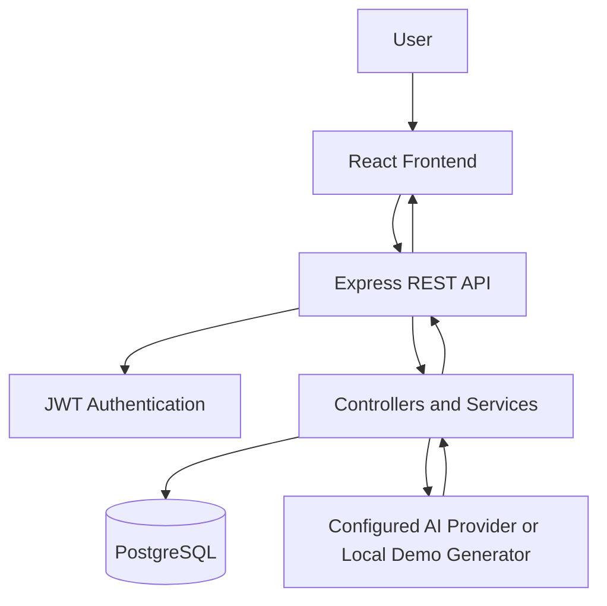
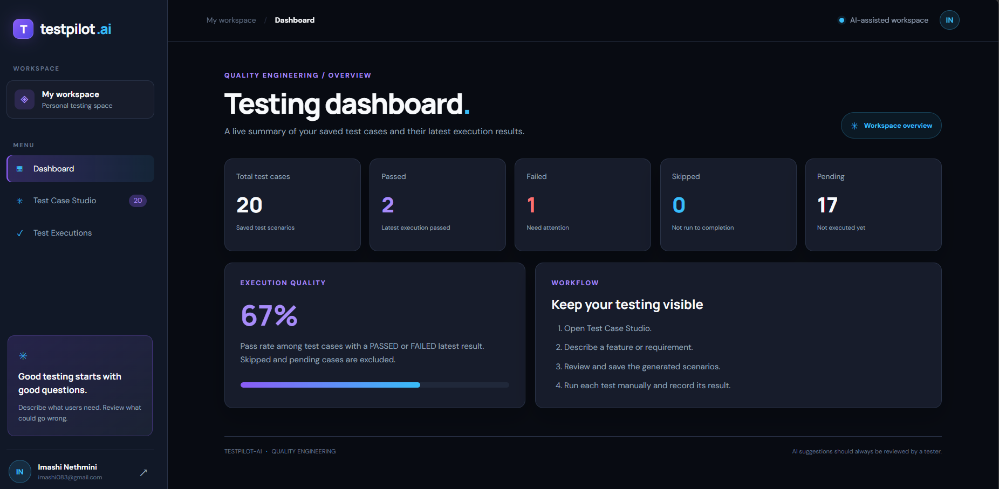

# TestPilot-AI – AI-Assisted Software Testing and Test Case Management System

An internship-level PERN application for generating, reviewing, and managing software test cases and recording manual test execution results.

## Overview

TestPilot-AI helps a user turn a software requirement into a set of suggested test scenarios. A user can review and edit the generated test cases, manually execute them, record PASSED, FAILED, or SKIPPED results, and monitor the latest results on a dashboard.

The application is built with PostgreSQL, Express.js, React.js, and Node.js (PERN).

## MVP Features

- User registration and login.
- Password hashing with bcryptjs and JWT-based protected API routes.
- AI-assisted test case generation from a requirement.
- A local demo generator when no AI API key is configured.
- View and edit saved test cases.
- Manual test execution with PASSED, FAILED, and SKIPPED results.
- Optional execution notes for failed tests.
- Dashboard statistics calculated from the latest execution result of each test case.
- Execution history for the current user.

**AI note:** When `LLM_API_KEY` is empty, the app uses a built-in local demo generator. This is not a live AI response. When the key is configured, the backend calls the configured OpenAI-compatible chat completions endpoint.

## Technology Stack

| Layer | Technologies |
|---|---|
| Frontend | React, JavaScript, Vite, React Router |
| Backend | Node.js, Express.js |
| Database | PostgreSQL, `pg` |
| Authentication | JWT, bcryptjs |
| API | REST over HTTP/JSON |
| Development | Git, GitHub, VS Code, Postman |

## Workflow

1. Register or sign in.
2. Enter a feature or software requirement in Test Case Studio.
3. Generate suggested test cases.
4. Review and edit the generated scenarios.
5. Save the updated cases.
6. Execute the cases manually and record a result.
7. Review the dashboard and execution history.

## Architecture



## Project Structure

```text
TestPilot-AI/
├── backend/
│   ├── .env.example
│   ├── package.json
│   └── src/
│       ├── config/database.js
│       ├── controllers/
│       │   ├── authController.js
│       │   └── qualityController.js
│       ├── db/setup.js
│       ├── middleware/authMiddleware.js
│       ├── routes/
│       │   ├── authRoutes.js
│       │   └── qualityRoutes.js
│       ├── services/testCaseGenerator.js
│       └── server.js
├── database/schema.sql
├── frontend/
│   ├── .env.example
│   ├── package.json
│   └── src/
│       ├── components/
│       ├── pages/
│       ├── services/api.js
│       ├── App.jsx
│       ├── main.jsx
│       └── styles.css
├── .gitignore
└── README.md
```

## Prerequisites

- Node.js 20 or later (Node.js 24 was used during development).
- npm.
- PostgreSQL 16 or a compatible PostgreSQL server.
- Git (to clone the repository).

## Run Locally

### 1. Clone the repository

```bash
git clone <YOUR_GITHUB_REPOSITORY_URL>
cd TestPilot-AI
```

### 2. Create the PostgreSQL database

Open `psql` or pgAdmin and create the database:

```sql
CREATE DATABASE testpilot_ai;
```

The schema script creates the application tables and inserts the default role records. It uses `CREATE TABLE IF NOT EXISTS` and does not drop existing tables.

### 3. Configure and start the backend

Open a terminal in the project root:

```bash
cd backend
npm install
```

Copy `backend/.env.example` to `backend/.env` and enter your local PostgreSQL password and a new random JWT secret. Do not commit the `.env` file.

Example local values (replace the password and secret):

```env
PORT=5000
DATABASE_URL=
DB_HOST=localhost
DB_PORT=5433
DB_NAME=testpilot_ai
DB_USER=postgres
DB_PASSWORD=your_postgresql_password
DB_SSL=false
JWT_SECRET=replace_with_a_long_random_secret
FRONTEND_ORIGIN=http://localhost:5173,http://localhost:5174
LLM_API_KEY=
LLM_BASE_URL=https://api.openai.com/v1
LLM_MODEL=gpt-4o-mini
```

Use either `DATABASE_URL` or the individual `DB_*` values. Leave `DATABASE_URL` empty when using the individual settings. Change `DB_PORT` to the port on which your PostgreSQL server is listening.

Initialize the schema:

```bash
npm run db:setup
```

Start the API:

```bash
npm run dev
```

The backend listens on `http://localhost:5000` by default. Check the database connection at:

```text
http://localhost:5000/api/health
```

A successful health response looks like:

```json
{"status":"ok","database":"connected"}
```

### 4. Configure and start the frontend

Open a second terminal in the project root:

```bash
cd frontend
npm install
```

Copy `frontend/.env.example` to `frontend/.env`:

```env
VITE_API_URL=http://localhost:5000/api
```

Start Vite:

```bash
npm run dev
```

Open the local URL printed by Vite (commonly `http://localhost:5173`; it may use another port if that port is already occupied). Ensure that the actual frontend origin is included in `FRONTEND_ORIGIN` in `backend/.env`, then restart the backend if you change that setting.

### 5. Build the frontend

From the `frontend` directory:

```bash
npm run build
```

## API Endpoints

All routes below are mounted by the Express server. The protected routes require an `Authorization: Bearer <token>` header.

| Method | Endpoint | Authentication | Description |
|---|---|---|---|
| POST | `/api/auth/register` | No | Register a user |
| POST | `/api/auth/login` | No | Sign in and receive a JWT |
| GET | `/api/auth/me` | Yes | Validate the token and return the current user |
| GET | `/api/test-cases` | Yes | List the signed-in user's test cases and latest execution status |
| GET | `/api/executions` | Yes | List the signed-in user's manual execution history |
| POST | `/api/requirements/generate` | Yes | Save a requirement and generate test cases |
| PATCH | `/api/test-cases/:id` | Yes | Update a test case |
| POST | `/api/test-cases/:id/executions` | Yes | Record a manual execution |
| GET | `/api/health` | No | Check API and database availability |

## Database Tables

The canonical schema is `database/schema.sql`. It defines:

- `roles`
- `users`
- `projects`
- `project_members`
- `requirements`
- `test_cases`
- `requirement_test_cases`
- `test_executions`
- `defects`
- `ai_analysis_records`

The MVP actively uses users, roles, projects, requirements, test cases, requirement-test-case links, executions, and AI analysis records. The presence of `project_members` and `defects` tables does not mean a complete team or defect-management UI is included.

## Manual Test Execution Statuses

| Status | Meaning |
|---|---|
| PASSED | The observed result matches the expected result. |
| FAILED | The observed result does not match the expected result. |
| SKIPPED | The test case was not run. |

A failed result can include an optional note. Test execution in this MVP is manual; it does not run the application under test automatically.

## Current Scope and Limitations

This MVP focuses on authentication, AI-assisted test case generation, test case review/editing, manual execution, and basic result monitoring.

Not included in this version:

- Automated browser execution with Playwright or Selenium.
- A full defect/bug tracking workflow.
- Full project CRUD or team collaboration.
- Full requirement approval and lifecycle management.
- CI/CD integration, notifications, or advanced reporting.

## Security Notes

- Keep real `.env` files out of Git.
- Use a unique, strong `JWT_SECRET` for each environment.
- Never put AI API keys in frontend code or commit them to the repository.
- The backend uses parameterized SQL queries for user-provided values.
- Do not use development credentials in production.
## Application Screenshots

### 1. Login Page


### 2. Dashboard

The dashboard provides an overview of test cases and their latest execution results.


### 3. Test Case Studio

Users can submit software requirements and generate test scenarios with Gemini AI assistance.


### 4. Generated Test Cases

Generated test cases can be reviewed, edited, and saved.


### 5. Test Executions

Users can manually execute test cases and record PASSED, FAILED, and SKIPPED results.


## Author

**Malshi Dewmini**  
Undergraduate Software Engineering Student

---

*TestPilot-AI — making software test design and manual execution easier to organize.*
