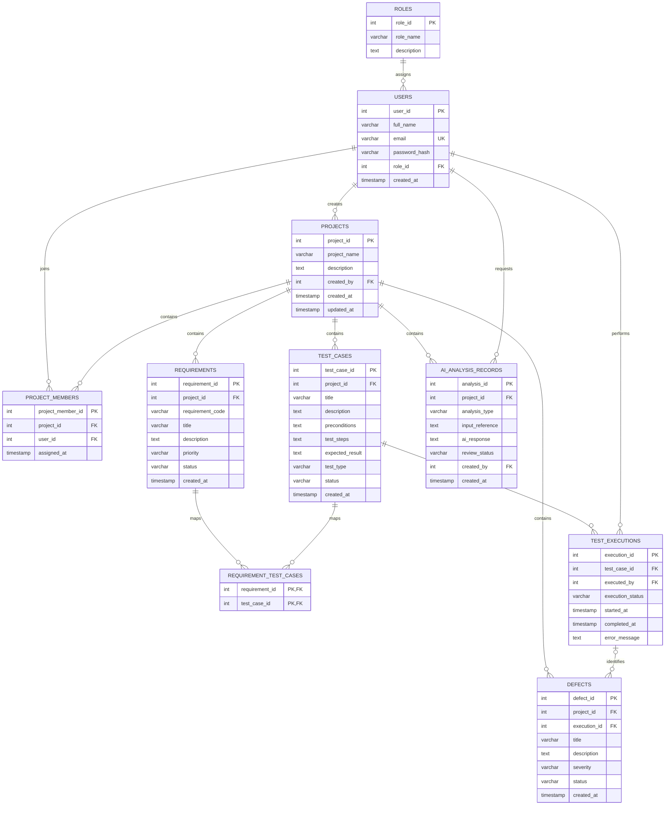

# TestPilot AI
## Entity Relationship Diagram (ERD)

**Document Version:** 1.0  
**Database:** PostgreSQL

## 1. Introduction

This document describes the Entity Relationship Diagram (ERD) of the TestPilot AI platform.

The ERD illustrates the database entities, their attributes, primary keys, foreign keys, and relationships.

## 2. Database Entities

The initial database consists of the following entities:

1. Users
2. Roles
3. Projects
4. Project_Members
5. Requirements
6. Test_Cases
7. Requirement_Test_Cases
8. Test_Executions
9. Defects
10. AI_Analysis_Records

## 3. Entity Relationships

| Relationship | Cardinality |
|---|---|
| Roles to Users | One-to-Many |
| Users to Projects | One-to-Many (creator) |
| Users to Projects | Many-to-Many through Project_Members |
| Projects to Requirements | One-to-Many |
| Projects to Test_Cases | One-to-Many |
| Requirements to Test_Cases | Many-to-Many |
| Test_Cases to Test_Executions | One-to-Many |
| Projects to Defects | One-to-Many |
| Test_Executions to Defects | One-to-Many (optional execution reference) |
| Projects to AI_Analysis_Records | One-to-Many |

## 4. ER Diagram

The following Mermaid ER diagram represents the proposed database structure.

## 5. Explanation of Relationships

### 5.1 Roles and Users

One role can be assigned to multiple users. Each user has an assigned role in the initial design.

**Relationship:** One-to-Many.

### 5.2 Users and Projects

A user can create multiple projects.

The Project_Members entity also allows multiple users to participate in projects.

**Relationship:** Many-to-Many through Project_Members.

### 5.3 Projects and Requirements

A project can contain multiple software requirements.

Each requirement belongs to one project.

**Relationship:** One-to-Many.

### 5.4 Requirements and Test Cases

A requirement can be linked to multiple test cases.

A test case can cover multiple requirements.

**Relationship:** Many-to-Many through Requirement_Test_Cases.

### 5.5 Test Cases and Test Executions

A test case can have multiple execution records because it may be executed repeatedly.

**Relationship:** One-to-Many.

### 5.6 Projects and Defects

A project can contain multiple identified defects.

**Relationship:** One-to-Many.

### 5.7 Projects and AI Analysis Records

A project can contain multiple AI analysis records.

**Relationship:** One-to-Many.

## 6. Conclusion

The ER diagram provides a visual representation of the TestPilot AI database structure.

It helps developers understand how information is stored and how database entities are connected.