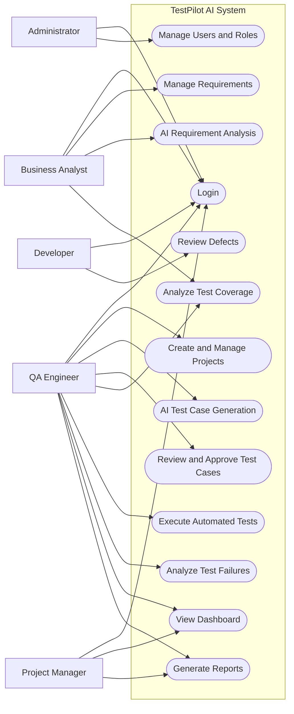

# TestPilot AI
## Use Case Diagram

**Document Version:** 1.0

## 1. Introduction

This document describes the use case diagram of the TestPilot AI platform.

The diagram illustrates the interactions between different system users (actors) and the functionalities provided by the platform.

## 2. Actors

| Actor | Description |
|---|---|
| Administrator | Manages users and system access |
| QA Engineer | Manages test cases and executes tests |
| Business Analyst | Creates and analyzes requirements |
| Developer | Reviews and investigates defects |
| Project Manager | Monitors project progress and reports |

## 3. Main Use Cases

### Administrator
- Manage Users
- Manage User Roles
- Monitor System

### QA Engineer
- Login
- Create Project
- Manage Test Cases
- Generate Test Cases Using AI
- Review and Approve Test Cases
- Analyze Test Coverage
- Execute Automated Tests
- Analyze Test Failures
- View Reports

### Business Analyst
- Login
- Manage Requirements
- Analyze Requirements Using AI
- View Test Coverage

### Developer
- Login
- View Failed Tests
- Review Defect Analysis
- Investigate Defects

### Project Manager
- Login
- View Dashboard
- Monitor Testing Progress
- Generate Reports

## 4. Use Case Diagram

The following Mermaid diagram represents the main actors and their interactions with TestPilot AI.

## 5. Use Case Description

### UC-01: AI Test Case Generation

**Primary Actor:** QA Engineer

**Precondition:** The QA Engineer must be logged in and have access to a project containing requirements.

**Main Flow:**
1. The QA Engineer opens a project.
2. The QA Engineer selects a requirement.
3. The QA Engineer requests AI test case generation.
4. The system sends the requirement information to the AI service.
5. The AI generates test case suggestions.
6. The system displays the suggestions.
7. The QA Engineer reviews the generated test cases.

**Postcondition:** Generated test cases are available for review.

### UC-02: Automated Test Execution

**Primary Actor:** QA Engineer

**Precondition:** An approved automated test must be available, and the target application must be authorized for testing.

**Main Flow:**
1. The QA Engineer selects an automated test.
2. The QA Engineer starts test execution.
3. The system executes the test using Playwright.
4. The system collects execution information.
5. The system stores the execution result.
6. The system displays the result.

**Postcondition:** Test execution information is stored and available for review.

## 6. Conclusion

The use case diagram provides an overview of how different users interact with the TestPilot AI platform.

It helps developers and stakeholders understand the functional boundaries of the system.